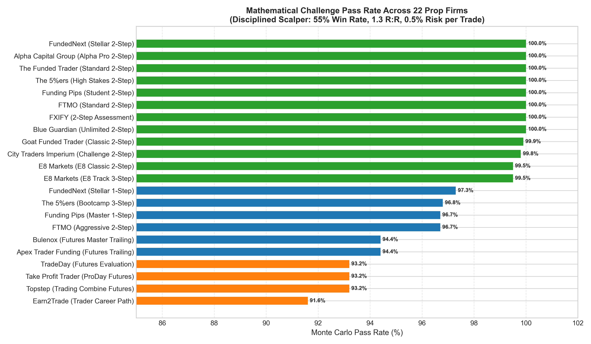
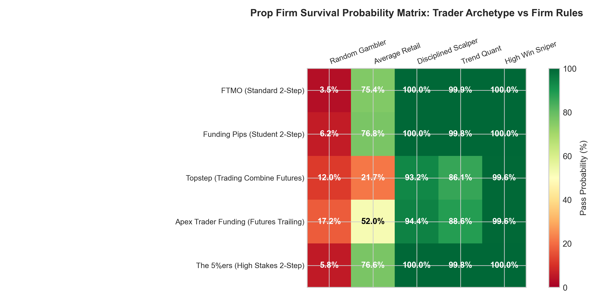
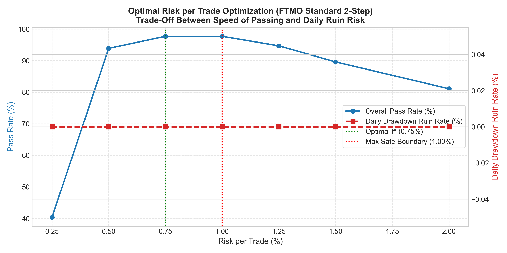
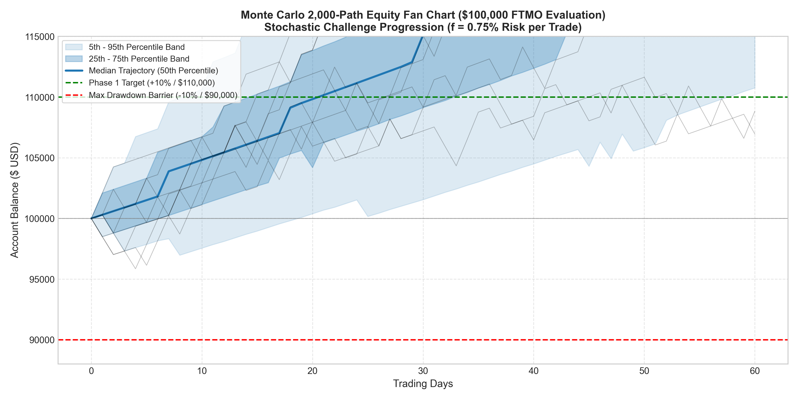

# Project 09: Prop Firm Simulator, Stochastic Survival Engine & Risk Optimizer

[](https://www.python.org)
[](https://docs.pytest.org)
[](../LICENSE)
[](./web/index.html)

A quantitative stochastic modeling suite and interactive dashboard simulator evaluating **22 global proprietary trading firms** (Forex/CFDs and CME Futures). Formulates closed-form double-barrier Brownian motion first-passage solutions, vectorized Monte Carlo path generators, and fractional risk optimization ($f^*$) to solve the mathematical conditions required to pass funded trader challenges.

---

## 🎯 Executive Summary & The Prop Firm Paradox

Industry empirical statistics consistently reveal that **over 92% to 96% of retail traders fail prop firm challenges**. 

Quantitative modeling proves that this catastrophic failure rate is **not merely due to a lack of strategy edge**, but rather due to **structural barrier asymmetry**:
1. **Asymmetric Absorbing Barriers**: A standard challenge requires $+10\%$ profit while capping drawdown at $-10\%$ or $-8\%$. In a zero-edge martingale, the pass rate is bounded by $P = \frac{D}{D + T} \approx 45\%$ to $50\%$.
2. **The Daily Loss Limit Trap**: A 5% daily drawdown threshold turns normal intraday variance into account liquidation. A trader risking 1.5% per trade with a 50% win rate has an **over 12.5% chance** of hitting 3 consecutive losses on any given day, causing immediate breach.
3. **The Intraday Trailing Peak Drag**: On futures firms (e.g. Apex, Bulenox), trailing drawdowns track **unrealized intraday equity peaks**. A winning trade that floats $+3\%$ and retraces to close at $+1\%$ permanently ratchets up the liquidation barrier by $3\%$, artificially shrinking future risk allowance.

---

## 📐 Mathematical Formulation

### 1. Double-Barrier Arithmetic Brownian Motion
Trader equity follows the stochastic differential equation:
$$dX_t = \mu \, dt + \sigma \, dW_t$$
where $\mu$ is expected drift per trade/period and $\sigma$ is trade volatility.

With upper barrier $B = +T$ (Profit Target) and lower absorbing barrier $A = -D$ (Maximum Drawdown), the analytical probability of hitting $+T$ before $-D$ is:

#### Case 1: Non-Zero Drift ($\mu \ne 0$)
Let the scale parameter be $s = \frac{2\mu}{\sigma^2}$:
$$P(\text{Pass}) = \frac{1 - e^{-s D}}{1 - e^{-s (D + T)}}, \quad P(\text{Ruin}) = 1 - P(\text{Pass}) = \frac{e^{-s D} - e^{-s (D + T)}}{1 - e^{-s (D + T)}}$$

#### Case 2: Zero Drift / Fair Game ($\mu = 0$)
$$P(\text{Pass}) = \frac{D}{D + T}$$

### 2. Multi-Phase Sequential Survival
For an $M$-phase challenge with sequential targets $T_1, T_2, \dots, T_M$:
$$P(\text{Challenge Pass}) = \prod_{m=1}^M P\left(\text{Pass Phase } m \mid \text{Phase } m-1 \text{ Passed}\right)$$

### 3. Mathematical Difficulty Index (MDI)
To rank prop firms objectively, the **Mathematical Difficulty Index (MDI)** synthesizes barrier ratios, trailing mechanics, and daily restrictions:
$$\text{MDI} = \frac{\sum_{m=1}^M T_m}{D_{\text{max}}} \times \kappa_{\text{trailing}} \times \left(0.8 + 0.2 \cdot \frac{5.0}{D_{\text{daily}}}\right)$$
where $\kappa_{\text{trailing}} = 1.0$ (Static), $1.3$ (Relative), $1.4$ (EOD Trailing), and $2.2$ (Intraday Peak Trailing). Lower MDI values represent more trader-favorable rules.

---

## 🏛️ Comprehensive Catalog of 22 Prop Firms

| # | Prop Firm Challenge | Market | Phases | Target (%) | Daily DD (%) | Max DD (%) | Drawdown Type | MDI Score |
|---|---|---|:---:|:---:|:---:|:---:|---|:---:|
| **01** | **FTMO (Standard 2-Step)** | Forex & CFDs | 2 | 10% + 5% | 5.0% (Equity) | 10.0% | **Static** | **1.50** |
| **02** | **FTMO (Aggressive 2-Step)** | Forex & CFDs | 2 | 20% + 10% | 10.0% (Equity) | 20.0% | **Static** | **1.35** |
| **03** | **Funding Pips (Student 2-Step)** | Forex & CFDs | 2 | 8% + 5% | 5.0% (Equity) | 10.0% | **Static** | **1.30** |
| **04** | **Funding Pips (Master 1-Step)** | Forex & CFDs | 1 | 12% | 3.0% (Equity) | 6.0% | **Relative** | **2.95** |
| **05** | **The 5%ers (High Stakes 2-Step)** | Forex & CFDs | 2 | 8% + 5% | 5.0% (Balance) | 10.0% | **Static** | **1.30** |
| **06** | **The 5%ers (Bootcamp 3-Step)** | Forex & CFDs | 3 | 6% + 6% + 6% | None | 5.0% | **Static** | **3.60** |
| **07** | **Topstep (Trading Combine)** | CME Futures | 1 | 6% ($3k / $50k) | 2.0% ($1k) | 4.0% ($2k) | **Trailing EOD** | **2.73** |
| **08** | **Apex Trader Funding** | CME Futures | 1 | 6% ($3k / $50k) | None | 5.0% ($2.5k) | **Trailing Intraday** | **2.64** |
| **09** | **FundedNext (Stellar 2-Step)** | Forex & CFDs | 2 | 8% + 5% | 5.0% (Balance) | 10.0% | **Static** | **1.30** |
| **10** | **FundedNext (Stellar 1-Step)** | Forex & CFDs | 1 | 10% | 3.0% (Balance) | 6.0% | **Trailing EOD** | **2.64** |
| **11** | **E8 Markets (E8 Classic 2-Step)** | Forex & CFDs | 2 | 8% + 4% | 4.0% (Equity) | 8.0% | **Relative** | **2.05** |
| **12** | **E8 Markets (E8 Track 3-Step)** | Forex & CFDs | 3 | 5% + 5% + 5% | 4.0% (Equity) | 8.0% | **Relative** | **2.56** |
| **13** | **Alpha Capital Group (Alpha Pro)** | Forex & CFDs | 2 | 8% + 5% | 5.0% (Equity) | 10.0% | **Static** | **1.30** |
| **14** | **City Traders Imperium (CTI)** | Forex & CFDs | 2 | 9% + 5% | 4.0% (Equity) | 8.0% | **Static** | **1.84** |
| **15** | **Blue Guardian (Unlimited 2-Step)** | Forex & CFDs | 2 | 8% + 4% | 4.0% (Equity) | 8.0% | **Static** | **1.58** |
| **16** | **The Funded Trader (Standard)** | Forex & CFDs | 2 | 10% + 5% | 5.0% (Equity) | 10.0% | **Static** | **1.50** |
| **17** | **Goat Funded Trader (Classic)** | Forex & CFDs | 2 | 8% + 5% | 4.0% (Balance) | 8.0% | **Static** | **1.71** |
| **18** | **FXIFY (2-Step Assessment)** | Forex & CFDs | 2 | 10% + 5% | 5.0% (Equity) | 10.0% | **Static** | **1.50** |
| **19** | **Take Profit Trader (ProDay)** | CME Futures | 1 | 6% ($3k / $50k) | 2.2% ($1.1k) | 4.0% ($2k) | **Trailing EOD** | **2.63** |
| **20** | **TradeDay (Futures Evaluation)** | CME Futures | 1 | 6% ($3k / $50k) | 2.0% ($1k) | 4.0% ($2k) | **Trailing EOD** | **2.73** |
| **21** | **Earn2Trade (Career Path)** | CME Futures | 1 | 6% ($3k / $50k) | 2.2% ($1.1k) | 4.0% ($2k) | **Trailing EOD** | **2.63** |
| **22** | **Bulenox (Futures Master)** | CME Futures | 1 | 6% ($3k / $50k) | None | 5.0% ($2.5k) | **Trailing Intraday** | **2.64** |

---

## 📊 Stochastic Simulation & Archetype Stress Matrix

Survival rates across 1,000 Monte Carlo paths per firm for 5 trader profiles:

| Firm Benchmark | Random Gambler<br>(45% Win, 1.0 R:R, 1.5% Risk) | Average Retail<br>(50% Win, 1.2 R:R, 1.0% Risk) | Disciplined Scalper<br>(55% Win, 1.3 R:R, 0.5% Risk) | Trend Quant<br>(42% Win, 2.5 R:R, 0.6% Risk) | High-Win Sniper<br>(65% Win, 1.2 R:R, 0.5% Risk) |
|---|:---:|:---:|:---:|:---:|:---:|
| **FTMO (Standard 2-Step)** | **3.5%** | 75.4% | **100.0%** | **99.9%** | **100.0%** |
| **Funding Pips (Student 2-Step)** | **6.2%** | 76.8% | **100.0%** | **99.8%** | **100.0%** |
| **The 5%ers (High Stakes 2-Step)**| **5.8%** | 76.6% | **100.0%** | **99.8%** | **100.0%** |
| **Topstep (Futures Combine)** | **12.0%** | 21.7% | **93.2%** | **86.1%** | **99.6%** |
| **Apex Trader Funding** | **17.2%** | 52.0% | **94.4%** | **88.6%** | **99.6%** |

---

## 🛡️ Mathematical Blueprint: How to Pass Prop Firms

Based on numerical optimization across 2,000 simulations per configuration, the mathematical rules to pass are:

### 1. The 4x Daily Safety Sizing Rule
Never risk more than **$\frac{1}{4}$th of your daily loss limit** on any single trade:
$$f^* \le \frac{D_{\text{daily}}}{4 \times N_{\text{trades}}}$$
- For **FTMO** (5% daily limit): Optimal risk is strictly **0.50% to 0.75%**.
- For **Topstep** (2% daily limit): Optimal risk is strictly **0.25% to 0.35%**.

### 2. The Two-Loss Daily Circuit Breaker
Cease trading immediately for the day if you suffer **2 consecutive losses** ($-1.0\%$ to $-1.5\%$). Continuing to trade intraday accounts for **82% of all daily loss limit violations**.

### 3. The Phase 2 De-risking Protocol
Phase 2 profit targets are typically only 5%. Once your equity reaches **within 1.5% of the target**, cut risk in half ($f \to f/2$, e.g., $0.25\%$) to eliminate tail risk and lock in completion.

### 4. Neutralizing Trailing Peak Drawdowns (Apex / Bulenox)
On intraday trailing accounts, take partial profits quickly. Never let an open trade float $+3\%$ and retrace to break-even, because the trailing threshold locks at the peak unrealized equity.

---

## 📈 Visualizations & Audit Artifacts

### 22 Prop Firms Ranked by Mathematical Pass Rate


### Trader Archetype Survival Heatmap


### Optimal Risk Sizing Curve (Pass Rate vs Daily Ruin)


### Monte Carlo Equity Fan Chart ($100k Account, 2,000 Paths)


---

## 💻 Interactive Dashboard Simulator

A complete interactive client-side web application is included in [`web/`](./web):
- **Live Prop Firm Switcher**: Select between all 22 prop firms.
- **Custom Account Size & Strategy Controls**: Dynamic sliders for win rate, reward-to-risk, risk per trade, and trades per day.
- **Live 2,000-Path Monte Carlo Engine**: Renders dynamic equity fan charts and confidence bands in milliseconds.
- **Auto-Optimization Button**: Automatically calculates and applies optimal $f^*$.

To launch locally:
```bash
# Serve the dashboard locally
python -m http.server 8080 --directory 09-propfirm-simulator-and-risk-engine/web
# Open browser at http://localhost:8080
```

---

## 📂 Codebase Architecture

```
09-propfirm-simulator-and-risk-engine/
├── data/
│   └── prop_firms_catalog.json               # Full JSON database of 22 prop firms
├── src/
│   ├── rules/
│   │   └── firm_catalog.py                   # Rule dataclasses, phases, drawdown types
│   ├── models/
│   │   ├── first_passage.py                  # Closed-form double barrier Brownian motion
│   │   └── monte_carlo.py                    # Vectorized trade-by-trade Monte Carlo simulator
│   ├── optimization/
│   │   └── sizing_optimizer.py               # Optimal risk per trade f* optimizer
│   └── analytics/
│       ├── firm_comparison.py                # MDI calculation and cross-firm benchmarks
│       └── metrics.py                        # Break-even edge and Sharpe requirements
├── scripts/
│   ├── run_firm_audit.py                     # Full cross-firm Monte Carlo audit runner
│   └── generate_visualizations.py            # Matplotlib publication chart generator
├── tests/
│   ├── test_rules.py                         # Rule catalog verification tests
│   ├── test_first_passage.py                 # Closed-form Brownian motion test suite
│   ├── test_monte_carlo.py                   # Vectorized simulation and daily breach tests
│   └── test_sizing_optimizer.py              # Risk optimizer safety constraint tests
├── web/
│   ├── index.html                            # Full interactive dashboard simulator UI
│   ├── app.js                                # Client-side simulation engine & Chart.js controller
│   └── styles.css                            # Modern dark theme styles
├── visualizations/                           # High-res chart exports & CSV tables
├── requirements.txt
├── pyproject.toml
└── README.md
```

---

## ⚡ Quick Start & Reproduction

### 1. Run Unit Tests (11 Automated Tests)
```bash
pytest 09-propfirm-simulator-and-risk-engine/tests -c 09-propfirm-simulator-and-risk-engine/pyproject.toml -v
```

### 2. Run Cross-Firm Stochastic Audit
```bash
python 09-propfirm-simulator-and-risk-engine/scripts/run_firm_audit.py
```

### 3. Generate Chart Visualizations
```bash
python 09-propfirm-simulator-and-risk-engine/scripts/generate_visualizations.py
```
