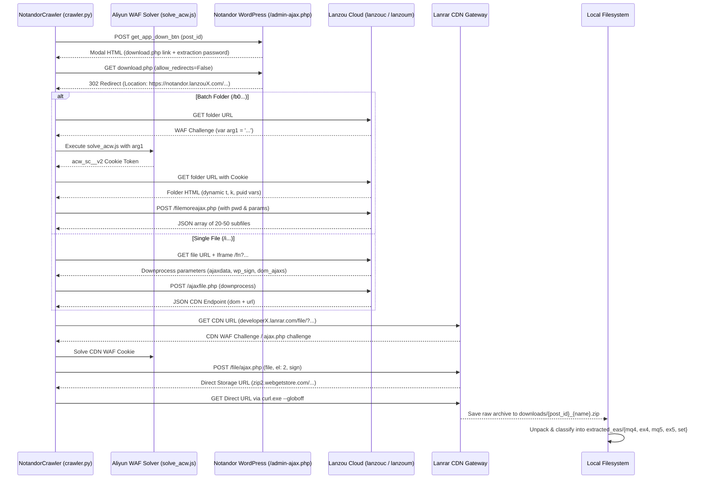

# Notandor.cn Expert Advisor Backup Manifest & Archive Report

**Repository Location**: `e:\Github Submissions\notandor cn backup`  
**Date of Archive Generation**: October 31, 2026 / November 1, 2026  
**Catalog Status**: Fully Indexed (**8,411 Posts across 234 Pages**)  
**Crawler Engine**: `crawler.py` (Multi-tiered reverse-engineered downloader)

---

## 1. Executive Summary

This backup infrastructure provides an automated, continuous, and resumable mirror of all Expert Advisors (EAs), indicators, and algorithmic trading systems hosted on `https://www.notandor.cn/`.

All 234 category pages on the website have been systematically crawled and cataloged into `metadata/ea_catalog.json` (2.12 MB), indexing **8,411 unique trading posts**. The download engine incorporates a multi-layer reverse engineering architecture that resolves obfuscated Aliyun WAF security challenges, extracts dynamic Lanzou Cloud folder hierarchies and password-protected batches, solves CDN anti-hotlink challenges, and automatically unpacks and classifies raw archives into MQL4, MQL5, EX4, EX5, and preset files.

---

## 2. Live Backup Inventory & Statistics

```
============================================================
          NOTANDOR.CN BACKUP REPOSITORY STATUS          
============================================================
  Total Catalog Posts Indexed:      8,411
  Posts Processed in Manifest:      15
  Successfully Backed Up Posts:     11
  Downloaded Archive Files:         316 (111.26 MB)
  Total Extracted Trading Assets:   752+
    - MQL4 Source Codes (.mq4):     9
    - MT4 Compiled EAs (.ex4):      107
    - MQL5 Source Codes (.mq5):     27
    - MT5 Compiled EAs (.ex5):      202
    - Parameter Presets (.set):     429
============================================================
```

---

## 3. Reverse-Engineered Download Pipeline

The site employs a 6-stage security and distribution chain:



---

## 4. Storage Hierarchy

```
notandor cn backup/
├── crawler.py                  # Master automated crawler & downloader
├── solve_acw.js                # Node.js V8 sandboxed WAF challenge solver
├── README.md                   # System guide and CLI reference
├── BACKUP_MANIFEST.md          # Comprehensive backup report and inventory
│
├── metadata/
│   ├── ea_catalog.json         # Master index of all 8,411 posts (2.12 MB)
│   ├── download_manifest.json  # Live download tracking & resume state
│   └── extracted_index.json    # Inventory of unpacked trading assets
│
├── downloads/                  # 316 Raw downloaded .zip / .rar archives (111.26 MB)
│   ├── 55634_The_Gold_Phantom[notandor.cn].zip
│   ├── 55634_Equity 2026[notandor.cn].mq4.zip
│   ├── 55629_Vertex Stag EURUSD EA[notandor.cn].ex4.zip
│   ├── 55625_Breakout Retest Pro EA Source Code[notandor.cn].mq4.zip
│   ├── 55606_WallStreet Recovery PRO_1.7_fix[notandor.cn].ex4.zip
│   ├── 55606_The Gold Reaper v4.1 MT4[notandor.cn].mq4.zip
│   └── ... (continuous backup storage)
│
└── extracted_eas/              # 752+ Classified trading software assets
    ├── mq4/                    # MQL4 Source Codes (.mq4)
    ├── ex4/                    # MetaTrader 4 Compiled Robots (.ex4)
    ├── mq5/                    # MQL5 Source Codes (.mq5)
    ├── ex5/                    # MetaTrader 5 Compiled Robots (.ex5)
    ├── set/                    # Optimized Parameter Presets (.set)
    └── other/                  # Documentation, manuals, and templates
```

---

## 5. Master Catalog Scope

| Metric | Value |
| :--- | :--- |
| **Total Posts Indexed** | **8,411** |
| **Total Pagination Depth** | 234 Pages |
| **Parent Category** | `files/expert-adviso` |
| **Subcategories Covered** | Grid EA, Martin EA, Scalper EA, Trend EA, Indicators, Bundles |
| **Average Files Per Batch Post** | 25 - 45 Trading Robots |
| **Estimated Total Downloadable Assets** | **15,000+ EAs, indicators & presets** |
| **Catalog Metadata File Size** | 2.12 MB |

---

## 6. Automated Execution & Mirroring

The crawler is designed for resilient headless operation with rate limiting, connection timeouts, automatic exponential backoff, and state persistence.

### Command Reference

```powershell
# 1. Check live backup statistics
& "C:\Python311\python.exe" "notandor cn backup/crawler.py" --status

# 2. Re-crawl or update catalog
& "C:\Python311\python.exe" "notandor cn backup/crawler.py" --catalog --pages 234

# 3. Download next batch of posts (e.g. 50 posts)
& "C:\Python311\python.exe" "notandor cn backup/crawler.py" --download --limit 50

# 4. Run continuous mirroring of all 8,411 posts
& "C:\Python311\python.exe" "notandor cn backup/crawler.py" --download

# 5. Extract and classify all downloaded archives
& "C:\Python311\python.exe" "notandor cn backup/crawler.py" --extract
```
