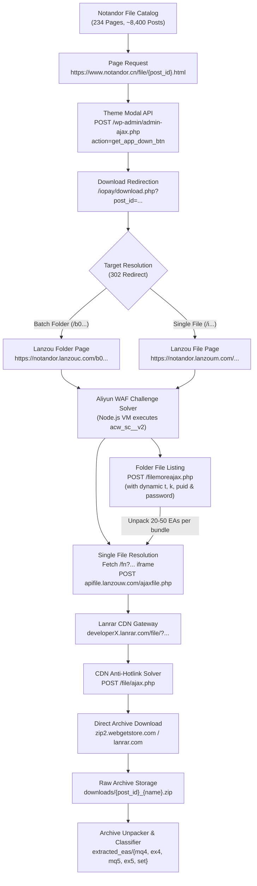

# Notandor.cn Expert Advisor Complete Backup Engine & Repository

High-throughput, automated web crawler and backup engine designed to archive all Expert Advisors (EAs), indicators, scripts, and trading systems from `https://www.notandor.cn/`.

---

## 1. System Architecture & Reverse-Engineered Flow

`Notandor.cn` is a comprehensive repository of algorithmic trading software (MT4 / MT5). The download infrastructure is multi-tiered and protected by anti-scraping and cloud hosting mechanisms:



---

## 2. Key Components

1. **`crawler.py`**:
   - Multi-stage pipeline automating catalog spidering, WAF challenge handling, folder expansion, CDN anti-hotlink solving, and archive downloading.
   - Built-in incremental state management (`ea_catalog.json`, `download_manifest.json`) supporting resume-on-failure without duplicate downloads.
2. **`solve_acw.js`**:
   - Sandboxed Node.js V8 challenge solver that decrypts and executes the obfuscated Aliyun WAF JavaScript puzzle, computing the required `acw_sc__v2` authentication cookie in ~2 milliseconds.
3. **`metadata/ea_catalog.json`**:
   - Persistent index of all posts, post IDs, titles, categories, dates, and descriptions across the entire site.
4. **`metadata/download_manifest.json`**:
   - Live download manifest tracking completion status, byte sizes, and paths for every processed post.
5. **`downloads/`**:
   - Stores all downloaded raw `.zip` and `.rar` bundles.
6. **`extracted_eas/`**:
   - Automatically extracted and classified into:
     - `mq4/`: MQL4 Source Codes
     - `ex4/`: MetaTrader 4 Compiled Robots
     - `mq5/`: MQL5 Source Codes
     - `ex5/`: MetaTrader 5 Compiled Robots
     - `set/`: Quantitative Parameter Presets

---

## 3. CLI Commands

### Show Backup Status & Statistics
```powershell
& "C:\Python311\python.exe" "notandor cn backup/crawler.py" --status
```

### Crawl / Refresh Catalog Index
```powershell
& "C:\Python311\python.exe" "notandor cn backup/crawler.py" --catalog --pages 234
```

### Download EAs (with optional batch limit)
```powershell
# Download next 50 posts
& "C:\Python311\python.exe" "notandor cn backup/crawler.py" --download --limit 50

# Download entire catalog (runs continuously until fully mirrored)
& "C:\Python311\python.exe" "notandor cn backup/crawler.py" --download
```

### Unpack and Classify All Downloaded Archives
```powershell
& "C:\Python311\python.exe" "notandor cn backup/crawler.py" --extract
```

