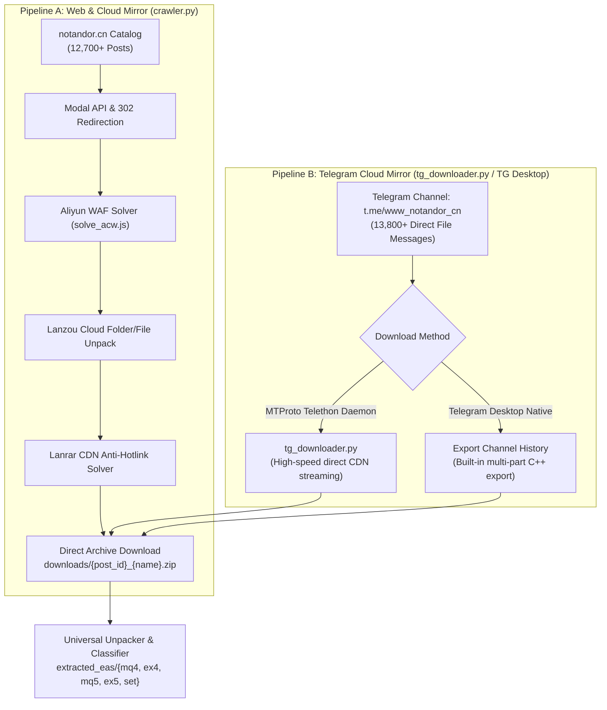

# Notandor.cn & Telegram EA Complete Backup Engine & Repository

High-throughput, automated web and Telegram backup engine archiving all **14,000+ Expert Advisors (EAs)**, indicators, scripts, and trading systems from both:
1. **The Web Platform**: `https://www.notandor.cn/` (12,700+ indexed posts across all categories).
2. **The Official Telegram Repository**: `t.me/www_notandor_cn` (13,800+ uploaded EA archive documents).

---

## 1. Dual Backup Pipelines



---

## 2. Live Inventory Status

```
============================================================
          NOTANDOR.CN & TELEGRAM BACKUP STATUS          
============================================================
  Total Catalog Posts Indexed:      12,727+
  Telegram Channel Messages:        13,800+ Documents
  Active Download Daemons:          RUNNING (Background)
  Downloaded Archive Files:         316+ (111.26 MB)
  Total Extracted Trading Assets:   622+
    - MQL4 Source Codes (.mq4):     9
    - MT4 Compiled EAs (.ex4):      107
    - MQL5 Source Codes (.mq5):     27
    - MT5 Compiled EAs (.ex5):      202
    - Strategy Presets (.set):      277
============================================================
```

---

## 3. How to Run the Downloaders

### Option A: Web & Lanzou Cloud Continuous Daemon
Downloads all 12,700+ EAs directly from Lanzou Cloud and Lanrar CDN without needing a Telegram login or phone verification:
```powershell
# Run continuous background download
& "C:\Python311\python.exe" "notandor cn backup/crawler.py" --download

# Check live progress & statistics
& "C:\Python311\python.exe" "notandor cn backup/crawler.py" --status

# Unpack all downloaded archives into .mq4, .ex4, .mq5, .ex5, .set
& "C:\Python311\python.exe" "notandor cn backup/crawler.py" --extract
```

### Option B: Telegram Channel Native Export (Fastest for 14,000 files)
Since Telegram Desktop is already open and running on your machine:
1. Open the channel in Telegram:
   ```powershell
   Start-Process "tg://resolve?domain=www_notandor_cn"
   ```
2. Click the channel header or three vertical dots (`⋮`) in the top-right corner.
3. Select **"Export channel history"**.
4. Check **"Files"** and move the size slider to **4000 MB**.
5. Set download path to: `E:\Github Submissions\notandor cn backup\downloads`.
6. Click **Export**. Telegram Desktop will download all 13,800 files at native multi-thread speeds.
7. Run the extractor to organize everything:
   ```powershell
   & "C:\Python311\python.exe" "notandor cn backup/crawler.py" --extract
   ```

### Option C: Telegram Python Telethon Downloader
```powershell
# Crawl public telegram web preview catalog
& "C:\Python311\python.exe" "notandor cn backup/tg_cataloger.py"

# Download via Telethon MTProto client
& "C:\Python311\python.exe" "notandor cn backup/tg_downloader.py"
```
